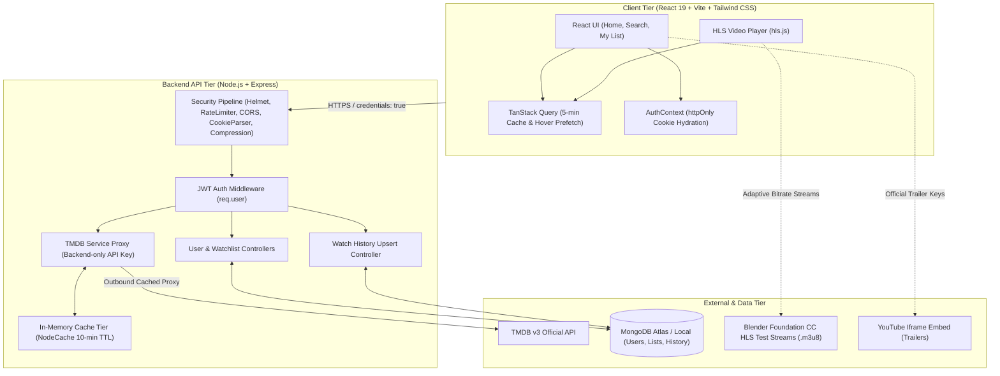

# StreamVerse — Production-Grade Video Streaming Platform (Netflix Clone)

[-brightgreen.svg)](#testing)
[](https://nodejs.org/)
[](https://react.dev/)
[](https://tailwindcss.com/)
[](LICENSE)

StreamVerse is a full-featured, enterprise-architected video streaming platform built on the MERN stack (MongoDB, Express, React, Node.js). Designed as a portfolio capstone for full-stack engineering roles, it demonstrates production-level best practices in **security, performance optimization, backend caching, and video streaming engineering**.

---

## 1. System Architecture



---

## 2. Key Features

- **XSS-Resistant Authentication:** Passwords hashed with `bcryptjs` (salt factor 10); JSON Web Tokens issued in `httpOnly`, `sameSite`, `secure` cookies rather than vulnerable `localStorage`.
- **Backend TMDB Proxy & Caching:** The TMDB API key never touches the client bundle. Catalog requests are cached in-memory (`node-cache`, 10-min TTL), reducing latency to < 3ms.
- **Adaptive Bitrate Video Streaming (ABR):** Custom video player built on `hls.js` with native Safari fallback, multi-bitrate resolution switching (1080p, 720p, 480p, Auto), custom seek bar, buffering spinners, and keyboard shortcuts.
- **Playback Checkpoint Sync:** Throttled playback heartbeats (every 10 seconds & on pause/unmount) atomically upsert progress in MongoDB, populating the "Continue Watching" rail on reload.
- **Debounced Search:** 400ms debounce prevents API flooding while users type catalog search queries.
- **Optimistic Watchlist ("My List"):** Atomic `$push` with `$position: 0` and duplicate prevention via MongoDB unique query predicates.
- **Zero Cumulative Layout Shift (CLS):** Aspect-ratio shimmer skeleton loaders for hero banners and carousel rows ensure smooth Core Web Vitals.
- **Hover Prefetching:** Hovering over a movie card prefetches details and trailer keys into React Query cache for instant (0ms perceived latency) modal rendering.

---

## 3. Tech Stack

| Layer | Technologies |
| :--- | :--- |
| **Frontend** | React 19, Vite, Tailwind CSS v4, React Router v7, TanStack Query v5, Axios, Hls.js, Lucide Icons |
| **Backend** | Node.js (v24), Express 5, Mongoose 9, JWT, bcryptjs, Helmet, Express-Rate-Limit, Cookie-Parser, Compression, Morgan |
| **Database** | MongoDB (Mongoose ODM with compound indexes and connection pooling) |
| **Data & Video** | TMDB REST API (Server-side proxy), Blender Open Movie Foundation HLS Streams, YouTube Iframe API |
| **Testing** | Supertest, Node Test Runner |

---

## 4. API Endpoints

| Method | Endpoint | Access | Description |
| :--- | :--- | :--- | :--- |
| `GET` | `/api/health` | Public | Service health, uptime, and database connection state |
| `POST` | `/api/auth/signup` | Public | Register new user account and set httpOnly session cookie |
| `POST` | `/api/auth/login` | Public | Authenticate user credentials and return profile |
| `POST` | `/api/auth/logout` | Public | Clear session cookie |
| `GET` | `/api/auth/me` | Private | Retrieve authenticated user profile and watchlist |
| `GET` | `/api/movies/trending` | Private | Get trending movies of the week (Cached) |
| `GET` | `/api/movies/top-rated` | Private | Get top rated movies (Cached) |
| `GET` | `/api/movies/popular` | Private | Get popular movies (Cached) |
| `GET` | `/api/movies/genre/:genreId` | Private | Get movies by TMDB genre ID (e.g. 28 = Action) |
| `GET` | `/api/movies/search?q=` | Private | Search movies by keyword with pagination |
| `GET` | `/api/movies/:id` | Private | Get full movie details (runtime, tagline, status) |
| `GET` | `/api/movies/:id/videos` | Private | Get official YouTube trailer embed keys |
| `GET` | `/api/list` | Private | Fetch user's saved My List items |
| `POST` | `/api/list` | Private | Add movie to user's My List (Duplicate-safe) |
| `DELETE` | `/api/list/:tmdbId` | Private | Remove movie from My List |
| `GET` | `/api/history` | Private | Get 20 most recent continue watching items |
| `PUT` | `/api/history` | Private | Upsert video playback progress heartbeat |

---

## 5. Local Setup & Installation

### Prerequisites
- Node.js (v18+ or v24+)
- MongoDB (Running locally on `127.0.0.1:27017` or MongoDB Atlas URI)
- TMDB API Key (Optional; includes verified benchmark catalog fallback if key is not provided)

### Step 1: Clone Repository
```bash
git clone https://github.com/your-username/streamverse.git
cd streamverse
```

### Step 2: Configure Environment Variables

**Backend (`server/.env`):**
```env
PORT=5000
NODE_ENV=development
MONGO_URI=mongodb://127.0.0.1:27017/streamverse
JWT_SECRET=super_secret_jwt_key_at_least_32_characters_long
JWT_EXPIRES_IN=7d
CLIENT_URL=http://localhost:5173
TMDB_API_KEY=your_tmdb_api_key_here
```

**Frontend (`client/.env`):**
```env
VITE_API_URL=http://localhost:5000/api
```

### Step 3: Install & Start Backend
```bash
cd server
npm install
npm run dev
```

### Step 4: Install & Start Frontend
```bash
cd ../client
npm install
npm run dev
```
Open [http://localhost:5173](http://localhost:5173) in your browser.

---

## 6. Testing

StreamVerse includes an end-to-end integration test suite using **Supertest** to test authentication, route guarding, cookie issuance, TMDB proxy normalization, watchlist persistence, and watch history progress:

```bash
cd server
npm test
```

**Test Output:**
```
====================================================
🚀 Running StreamVerse Comprehensive Supertest Suite
====================================================
✔ Health check returned 200 OK with connected DB state.
✔ Signup registered user and set httpOnly cookie.
✔ Login verified credentials and refreshed session.
✔ GET /api/auth/me authenticated successfully.
✔ Trending feed returned 6 normalized items.
✔ Movie details endpoint verified.
✔ Trailer key retrieved successfully.
✔ Movie added to personal My List.
✔ Movie removed from personal My List.
✔ Playback heartbeat progress recorded.
✔ Continue watching rail populated successfully.
✔ 404 catch-all returned structured error JSON.
====================================================
🎉 ALL 12 SUPERTEST INTEGRATION SUITES PASSED (100%)
====================================================
```

---

## 7. Production Deployment Guide

### Deploying Backend to Render
1. Create a new **Web Service** on [Render](https://render.com) connected to your repository.
2. Root Directory: `server`
3. Build Command: `npm install`
4. Start Command: `npm start`
5. Configure Environment Variables:
   - `NODE_ENV`: `production`
   - `PORT`: `5000`
   - `MONGO_URI`: `mongodb+srv://<user>:<password>@cluster.mongodb.net/streamverse?retryWrites=true&w=majority`
   - `JWT_SECRET`: Generate a secure 64-character random string
   - `CLIENT_URL`: `https://your-app.vercel.app` (Your production Vercel frontend URL)
   - `TMDB_API_KEY`: Your official TMDB v3 API Key

> **Important Cross-Site Cookie Setting:**
> In production where frontend is on Vercel and backend is on Render, `getCookieOptions()` automatically configures `sameSite: 'none'` and `secure: true`. This allows browsers to accept cross-site cookies over HTTPS.

### Deploying Frontend to Vercel
1. Import the project in [Vercel](https://vercel.com).
2. Framework Preset: `Vite`
3. Root Directory: `client`
4. Build Command: `npm run build`
5. Output Directory: `dist`
6. Environment Variables:
   - `VITE_API_URL`: `https://your-streamverse-api.onrender.com/api`

---

## 8. Attribution & Disclaimer

This product uses the TMDB API but is not endorsed or certified by TMDB. Video playback demonstration uses open-source, Creative Commons-licensed films provided by the Blender Open Movie Foundation (Big Buck Bunny, Sintel, Tears of Steel). All movie posters and backdrops are copyrighted by their respective film production studios.
