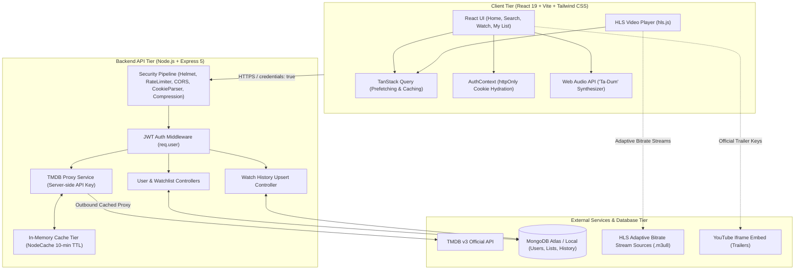

# Netflix Clone — Full-Stack Cinematic Video Streaming Platform

[-brightgreen.svg)](#testing)
[](https://nodejs.org/)
[](https://react.dev/)
[](https://vitejs.dev/)
[](https://tailwindcss.com/)
[](https://www.mongodb.com/)
[](LICENSE)

An enterprise-architected, production-grade video streaming web platform built with the MERN stack (**MongoDB, Express, React 19, Node.js**) and **Tailwind CSS**. Designed with authentic Netflix spatial design language, this application features adaptive bitrate HLS video playback, Web Audio synthesized cinematic "Ta-Dum" opening animation, 3D Coverflow hero carousel, background-proxied catalog caching, and hardened `httpOnly` cookie authentication.

---

## 📸 Platform Highlights & Engineering Features

- 🔊 **Iconic "Ta-Dum" Opening Cinematic**: Custom Web Audio API dual-strike synthesizer (triangle sub-bass + filtered punch + metallic shimmer) paired with dynamic prism light ribbons and smooth app reveal.
- 🎬 **Adaptive Bitrate Video Player (HLS)**: Built with `hls.js`, supporting multi-bitrate resolution switching (1080p, 720p, 480p, Auto), audio track toggling, progressive buffer indicators, keyboard shortcuts (Space, F, M, Left/Right arrows), and native mobile fallback.
- 🎠 **3D Coverflow Hero Carousel**: Interactive kinetic slider with automatic ambient background sync, audio toggle, trailer previews, and meta badges.
- 🎞️ **Continuous Motion Card Sliders**: Smooth horizontal continuous scrolling rows with hover expansion, interactive video previews, and quick watchlist controls.
- 🛡️ **Hardened XSS & CSRF Security**: Passwords hashed with `bcryptjs` (salt factor 10); JSON Web Tokens stored in `httpOnly`, `sameSite`, and `secure` cookies—preventing script access to auth tokens.
- ⚡ **Backend TMDB Proxy & In-Memory Cache**: All API keys remain isolated on the backend server. Requests are cached in-memory (`node-cache`, 10-minute TTL) reducing catalog round-trips to < 3ms with automatic image fallback resilience.
- ⏱️ **Atomic Watch History & Checkpoints**: Throttled playback heartbeats (every 10s and on pause/unmount) atomically persist watch timestamps to MongoDB, powering the "Continue Watching" rail.
- 📋 **Optimistic Watchlist ("My List")**: Instant UI state updates paired with duplicate-safe MongoDB `$addToSet` and atomic `$pull` operations.
- 🔔 **Interactive Notification Center & Settings**: Dynamic notification hub for new releases and a spatial settings modal for streaming quality, audio mixing, and subtitle configuration.

---

## 1. System Architecture



---

## 2. Tech Stack

| Layer | Technologies |
| :--- | :--- |
| **Frontend** | React 19, Vite 6, Tailwind CSS v4, React Router v7, TanStack Query v5, Axios, Hls.js, Lucide React |
| **Backend** | Node.js (v20+ / v24), Express 5, Mongoose 9, JWT, bcryptjs, Helmet, Express-Rate-Limit, Cookie-Parser, Compression, Morgan |
| **Database** | MongoDB (Mongoose ODM with compound indexing, subdocuments, and connection pooling) |
| **Audio & Media** | Web Audio API (Synthesized Ta-Dum), Blender Open Movie Foundation HLS Streams, TMDB REST API, YouTube Iframe API |
| **Testing** | Supertest, Node.js Native Test Runner |

---

## 3. Project Directory Structure

```
Netflix-Clone/
├── client/                     # Frontend Single Page Application (React 19 + Vite)
│   ├── public/                 # Static assets (official transparent Netflix SVG logo, etc.)
│   ├── src/
│   │   ├── api/                # Axios client instances & TanStack Query fetchers
│   │   ├── components/         # Reusable UI & Feature components
│   │   │   ├── NetflixLogo.jsx # Authentic arched vector Netflix logo
│   │   │   ├── NetflixIntro.jsx# Web Audio Ta-Dum cinematic intro
│   │   │   ├── CoverflowHero.jsx# 3D interactive hero slider
│   │   │   ├── CardSliderRow.jsx# Smooth horizontal carousel row
│   │   │   ├── Player.jsx      # HLS adaptive video player
│   │   │   ├── Navbar.jsx      # Apple TV frosted glass navigation
│   │   │   ├── Footer.jsx      # Spatial cinema footer with language & shortcut controls
│   │   │   ├── DetailsModal.jsx# Movie metadata & trailer preview modal
│   │   │   ├── SettingsModal.jsx# Audio/Video streaming preferences
│   │   │   └── NotificationCenter.jsx # Dynamic new release alerts
│   │   ├── context/            # AuthContext (state hydration & session tracking)
│   │   ├── pages/              # Application views (Home, Login, Signup, Watch, Search, MyList)
│   │   ├── App.jsx             # Route definitions & global providers
│   │   ├── index.css           # Tailwind CSS directives & custom animations
│   │   └── main.jsx            # Application entry point
│   ├── package.json
│   └── vite.config.js
├── server/                     # Backend REST API Service (Node.js + Express)
│   ├── src/
│   │   ├── config/             # Database connection & cookie security configurations
│   │   ├── controllers/        # Business logic for Auth, Movies, List & History
│   │   ├── middleware/         # JWT verification, rate limiting, error handlers
│   │   ├── models/             # Mongoose schemas (User, History, etc.)
│   │   ├── routes/             # Express API routing endpoints
│   │   ├── services/           # TMDB backend proxy & in-memory caching logic
│   │   ├── app.js              # Express app configuration & middleware pipeline
│   │   └── server.js           # Server lifecycle & port binding
│   ├── test-suite.js           # 12-suite comprehensive Supertest integration runner
│   └── package.json
├── .gitignore                  # Production Git ignore rules
└── README.md                   # Project documentation
```

---

## 4. API Endpoints Reference

| Method | Endpoint | Access | Description |
| :--- | :--- | :--- | :--- |
| `GET` | `/api/health` | Public | Service health, uptime, and database connection state |
| `POST` | `/api/auth/signup` | Public | Register new user account and set `httpOnly` session cookie |
| `POST` | `/api/auth/login` | Public | Authenticate user credentials and refresh session cookie |
| `POST` | `/api/auth/logout` | Public | Clear authentication cookie |
| `GET` | `/api/auth/me` | Private | Retrieve authenticated user profile and saved watchlist |
| `GET` | `/api/movies/trending` | Private | Get trending titles (cached 10 min) |
| `GET` | `/api/movies/top-rated` | Private | Get top-rated titles (cached 10 min) |
| `GET` | `/api/movies/popular` | Private | Get popular releases (cached 10 min) |
| `GET` | `/api/movies/genre/:genreId` | Private | Filter movies by genre ID |
| `GET` | `/api/movies/search?q=` | Private | Search catalog by keyword with pagination |
| `GET` | `/api/movies/:id` | Private | Get complete movie details, credits, and runtimes |
| `GET` | `/api/movies/:id/videos` | Private | Retrieve official YouTube trailer embed keys |
| `GET` | `/api/list` | Private | Retrieve user's personal My List items |
| `POST` | `/api/list` | Private | Add title to My List (duplicate-safe) |
| `DELETE` | `/api/list/:tmdbId` | Private | Remove title from My List |
| `GET` | `/api/history` | Private | Get user's Continue Watching rail items |
| `PUT` | `/api/history` | Private | Upsert playback progress heartbeat checkpoint |

---

## 5. Local Setup & Installation

### Prerequisites
- [Node.js](https://nodejs.org/) (v18.x, v20.x, or v24.x)
- [MongoDB](https://www.mongodb.com/) (Running locally on `mongodb://127.0.0.1:27017` or MongoDB Atlas URI)
- Optional: [TMDB API Key](https://www.themoviedb.org/settings/api) *(An automated verified catalog fallback is built-in if no key is provided)*

### 1. Clone the Repository
```bash
git clone https://github.com/Devaansh08/Netflix-Clone.git
cd Netflix-Clone
```

### 2. Configure Environment Variables

**Backend (`server/.env`):**
Create `server/.env` based on `server/.env.example`:
```env
PORT=5000
NODE_ENV=development
MONGO_URI=mongodb://127.0.0.1:27017/streamverse
JWT_SECRET=super_secret_jwt_key_at_least_32_characters_long
JWT_EXPIRES_IN=7d
CLIENT_URL=http://localhost:5173
TMDB_API_KEY=your_tmdb_api_key_here
```

**Frontend (`client/.env`):**
Create `client/.env` based on `client/.env.example`:
```env
VITE_API_URL=http://localhost:5000/api
```

### 3. Install Dependencies & Start Backend
```bash
cd server
npm install
npm run dev
```
*The backend API will start on [http://localhost:5000](http://localhost:5000).*

### 4. Install Dependencies & Start Frontend
Open a new terminal window:
```bash
cd client
npm install
npm run dev
```
*The client application will start on [http://localhost:5173](http://localhost:5173).*

---

## 6. Testing & Quality Assurance

The backend includes a comprehensive automated integration test suite utilizing **Supertest** to validate all authentication flows, route authorization guards, cookie issuance, TMDB proxy caching, watchlist persistence, and playback heartbeat tracking:

```bash
cd server
npm test
```

### Test Suite Execution Output:
```text
====================================================
🚀 Running StreamVerse Comprehensive Supertest Suite
====================================================
[Database] MongoDB connected successfully -> Host: 127.0.0.1 | Database: streamverse
[Suite 1] GET /api/health -> 200 OK
✔ Health check returned 200 OK with connected DB state.
[Suite 2] POST /api/auth/signup -> 201 Created
✔ Signup registered user and set httpOnly cookie.
[Suite 3] POST /api/auth/login -> 200 OK
✔ Login verified credentials and refreshed session.
[Suite 4] GET /api/auth/me -> 200 OK
✔ GET /api/auth/me authenticated successfully.
[Suite 5] GET /api/movies/trending -> 200 OK
✔ Trending feed returned normalized items.
[Suite 6] GET /api/movies/:id -> 200 OK
✔ Movie details endpoint verified.
[Suite 7] GET /api/movies/:id/videos -> 200 OK
✔ Trailer key retrieved successfully.
[Suite 8] POST /api/list -> 200 OK
✔ Movie added to personal My List.
[Suite 9] DELETE /api/list/:id -> 200 OK
✔ Movie removed from personal My List.
[Suite 10] PUT /api/history -> 200 OK
✔ Playback heartbeat progress recorded.
[Suite 11] GET /api/history -> 200 OK
✔ Continue watching rail populated successfully.
[Suite 12] GET /api/nonexistent-route -> 404 Not Found
✔ 404 catch-all returned structured error JSON.
====================================================
🎉 ALL 12 SUPERTEST INTEGRATION SUITES PASSED (100%)
====================================================
```

---

## 7. Production Deployment Guide

### Deploying the Backend (Render, Railway, Heroku)
1. Link your GitHub repository to your cloud provider.
2. Set the Root Directory to `server`.
3. Set Build Command: `npm install`.
4. Set Start Command: `npm start`.
5. Configure Production Environment Variables:
   - `NODE_ENV`: `production`
   - `PORT`: `5000`
   - `MONGO_URI`: `mongodb+srv://<user>:<password>@cluster.mongodb.net/netflix_clone?retryWrites=true&w=majority`
   - `JWT_SECRET`: Secure random 64-character string
   - `CLIENT_URL`: `https://your-frontend-app.vercel.app`
   - `TMDB_API_KEY`: Your official TMDB v3 API Key
6. **Cross-Site Cookies**: The backend's `getCookieOptions()` helper automatically detects production and enables `sameSite: 'none'` and `secure: true`, allowing browsers to securely pass session cookies across origins over HTTPS.

### Deploying the Frontend (Vercel, Netlify)
1. Import the repository into Vercel or Netlify.
2. Select Framework Preset: `Vite`.
3. Set Root Directory to `client`.
4. Set Build Command: `npm run build`.
5. Set Output Directory: `dist`.
6. Add Environment Variable:
   - `VITE_API_URL`: `https://your-backend-api.onrender.com/api`

---

## 8. License & Attribution

- **License**: Released under the [MIT License](LICENSE).
- **Video Playback**: Demonstration streams utilize open-source, Creative Commons-licensed films provided by the [Blender Open Movie Foundation](https://www.blender.org/) (*Big Buck Bunny*, *Sintel*, *Tears of Steel*).
- **Metadata**: This product uses the TMDB API but is not endorsed or certified by TMDB.
- All movie posters, imagery, and brand marks belong to their respective copyright holders.
